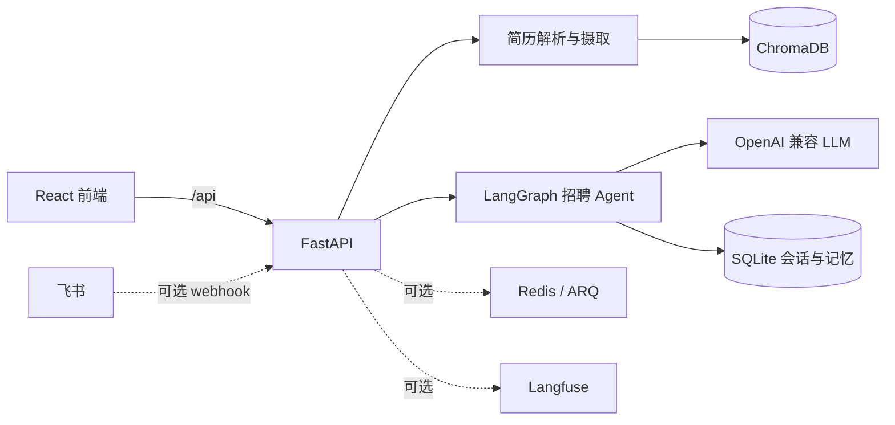

# AI 招聘助手

这是一个用于简历入库、语义检索、岗位匹配和自然语言招聘问答的全栈项目。后端使用 FastAPI、LangGraph 和 ChromaDB，前端使用 React。LLM 与 Embedding 通过 OpenAI 兼容配置调用，当前示例配置为 Azure OpenAI。

## 当前能力

- 上传 PDF 简历，提取文本、候选人信息并建立向量索引。
- 用自然语言搜索人才，按岗位描述评分和排序。
- 通过 LangGraph Agent 对话查询候选人，并读取候选人完整简历。
- 使用 SQLite 保存会话检查点和长期记忆；长期记忆通过向量检索召回。
- 可选 Redis/ARQ 简历摄取队列，支持按文件哈希幂等处理、任务状态查询和失败恢复。
- 可选飞书机器人 webhook 与 Langfuse Agent 观测。
- 使用 Docker Compose 部署前后端，ChromaDB、简历文件和 SQLite 数据保存在宿主机挂载目录。

KEV/Laya 预筛、岗位级通过/待复核/不匹配状态、人工复核队列目前尚未实现。本仓库这一版可作为后续模型初筛功能的开发基线。

## 架构



## 本地运行

环境要求：Python 3.11、Node.js 20，以及可访问的 Azure OpenAI 或其他兼容服务。

### 后端

在 PowerShell 中：

```powershell
cd backend
py -3.11 -m venv .venv
.\.venv\Scripts\Activate.ps1
pip install -r requirements.txt
Copy-Item .env.example .env
```

编辑 `backend/.env`，至少填写 `AZURE_OPENAI_ENDPOINT`、`AZURE_OPENAI_API_KEY`、聊天模型和 Embedding 模型。然后启动：

```powershell
python -m app.main
```

API 文档：<http://localhost:8000/docs>；健康检查：<http://localhost:8000/health>。

### 前端

另开终端：

```powershell
cd frontend
npm ci
npm run dev
```

Vite 开发服务器地址见启动输出。前端默认请求同源 `/api`，本地代理配置见 `frontend/vite.config.js`。

## Docker Compose

在仓库根目录创建 `backend/.env` 并填写模型服务配置，然后运行：

```bash
docker compose config --quiet
docker compose up -d --build
docker compose ps
docker compose logs -f backend
```

Compose 默认关闭 Redis 队列，使用同步简历摄取；前端容器绑定到 `127.0.0.1:8080`，适合由服务器现有 Nginx 代理 HTTPS 流量。数据挂载在 `backend/chroma_db` 和 `backend/data`。升级时保留这两个目录，不要执行会删除数据卷或目录的清理操作。

更完整的部署说明见 [DEPLOYMENT.md](DEPLOYMENT.md)。

## API

主要接口都挂在 `/api` 下：

| 接口 | 用途 |
|---|---|
| `POST /api/upload-resume` | 上传并摄取 PDF 简历 |
| `GET /api/upload-jobs/{job_id}` | 查询异步摄取状态 |
| `GET /api/resumes/count`、`GET /api/resumes/list` | 查看人才库 |
| `POST /api/search-resumes` | 语义检索简历 |
| `POST /api/score-resume` | 简历与岗位描述评分 |
| `POST /api/rank-candidates` | 检索并排序候选人 |
| `POST /api/chat` | 与招聘 Agent 对话 |
| `/api/memories` | 管理用户长期记忆 |
| `POST /api/feishu/events` | 可选飞书事件回调 |

完整请求与响应结构以运行中的 FastAPI 文档为准：`/docs`。

## 测试与评估

```powershell
cd backend
python -m pytest tests -q
```

前端生产构建：

```powershell
cd frontend
npm ci
npm run build
```

RAG 对话评估工具和说明位于 `backend/evals/`。样本需由使用者在本机准备，可通过 `--cases` 指向私有 JSONL；评估结果保存在本地并由 `.gitignore` 排除。样本与结果可能包含候选人信息，不应提交到 Git 仓库。

## 重要数据与凭证

- `backend/.env` 存放密钥，禁止提交。
- `backend/data/` 保存上传的简历、检查点、记忆和摄取任务文件。
- `backend/chroma_db/` 保存简历向量索引。
- 这些目录不属于代码发布产物，部署前后需要单独备份和保护。
- Langfuse 默认关闭；启用时 `LANGFUSE_CAPTURE_CONTENT=false` 会保留提示词和简历正文脱敏的默认行为。

当前代码变更基线和已知边界见 [CHANGELOG.md](CHANGELOG.md)。
