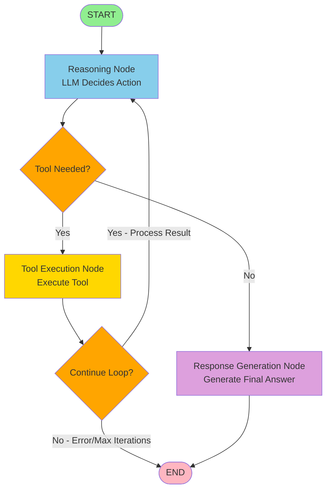

# LangGraph Agent Architecture

## Overview

This document explains the refactored recruitment agent that now uses **LangGraph** instead of a loop-based tool-calling approach.

## Architecture Changes

### Before: Loop-Based Agent
```
User Query → [Loop: LLM → Tool Call → LLM → ...] (max 5 iterations) → Response
```

**Problems:**
- Uncontrolled loops with arbitrary iteration limits
- Hard to debug and visualize
- Potential for infinite loops if not carefully managed
- Difficult to extend with complex multi-step workflows

### After: LangGraph Structured Workflow
```
User Query → START → Reasoning Node → [Tool Decision] → Tool Execution → Reasoning → Response Generation → END
```

**Benefits:**
✓ Structured, explicit state transitions
✓ No uncontrolled loops - built-in iteration management
✓ Easy to visualize and debug
✓ Modular - add new nodes without breaking existing logic
✓ Better error handling
✓ Supports complex multi-step workflows

---

## Workflow Graph



---

## Components

### 1. State Schema (`graph_state.py`)

The `AgentState` is a shared state object that flows through all nodes:

```python
class AgentState(TypedDict):
    # User input
    user_question: str
    chat_history: Optional[List[tuple[str, str]]]
    
    # RAG retrieval
    retrieved_chunks: Optional[List[Dict[str, Any]]]
    retrieval_context: Optional[str]
    
    # LLM reasoning
    llm_reasoning: Optional[str]
    
    # Tool decision
    needs_tool: bool
    tool_name: Optional[str]
    tool_arguments: Optional[Dict[str, Any]]
    
    # Tool execution
    tool_result: Optional[str]
    tool_calls_made: List[str]  # Tracks all tools called
    
    # Error handling
    error: Optional[str]
    
    # Final output
    final_answer: Optional[str]
    
    # Workflow control
    iteration_count: int
    max_iterations: int
```

### 2. Graph Nodes (`graph_nodes.py`)

**Reasoning Node:**
- LLM analyzes user query and context
- Decides if a tool call is needed
- If yes: specifies tool name and arguments
- If no: generates final answer directly

**Tool Execution Node:**
- Executes the specified tool with given arguments
- Stores result in state
- Handles errors gracefully
- Tracks tools used

**Response Generation Node:**
- Generates final user-facing response
- Called when no tools are needed
- Uses LLM to format answer naturally

### 3. Conditional Routing

**`should_use_tool(state)`:**
- Routes from Reasoning Node
- If `needs_tool == True` → go to Tool Execution
- Otherwise → go to Response Generation

**`should_continue_loop(state)`:**
- Routes from Tool Execution Node
- If tool executed successfully → loop back to Reasoning (so LLM can process result)
- If error or max iterations → END

### 4. Workflow Definition (`workflow.py`)

Creates and compiles the LangGraph workflow:

```python
workflow = create_recruitment_workflow(
    llm=llm_instance,
    tools_dict=tools_dictionary,
    verbose=True
)
```

### 5. Agent Orchestrator (`recruitment_agent.py`)

Main interface that:
1. Initializes the LangGraph workflow
2. Provides `process_query()` method
3. Maintains same API as before (for backward compatibility)

---

## Example Usage

### Basic Example

```python
from app.llm.llm_client import LLMClient
from app.agents.recruitment_agent import RecruitmentAgent
from app.agents.tools import (
    create_search_candidates_tool,
    create_list_all_candidates_tool,
    create_get_candidate_details_tool
)

# Initialize LLM client
llm_client = LLMClient()

# Create tools
tools = [
    create_search_candidates_tool(retrieval_pipeline),
    create_list_all_candidates_tool(retrieval_pipeline),
    create_get_candidate_details_tool(retrieval_pipeline)
]

# Initialize agent with LangGraph workflow
agent = RecruitmentAgent(
    llm_client=llm_client,
    tools=tools,
    max_iterations=5,
    verbose=True  # Enable detailed logging
)

# Process a query
result = await agent.process_query(
    query="Find Python developers with 5+ years experience",
    chat_history=[]
)

print(result["response"])  # Natural language response
print(result["tools_used"])  # ['search_candidates']
print(result["success"])  # True
```

### FastAPI Integration

The existing FastAPI endpoint continues to work without changes:

```python
@router.post("/chat", response_model=ChatResponse)
async def chat(
    request: ChatRequest,
    agent: RecruitmentAgent = Depends(get_recruitment_agent)
):
    """Chat endpoint using LangGraph AI Agent."""
    
    # Convert chat history
    chat_history = []
    if request.chat_history:
        for msg in request.chat_history:
            role = msg.get("role")
            content = msg.get("content")
            if role == "user":
                chat_history.append(("human", content))
            elif role == "assistant":
                chat_history.append(("ai", content))
    
    # Process with LangGraph workflow
    result = await agent.process_query(
        query=request.message,
        chat_history=chat_history
    )
    
    return ChatResponse(
        message=request.message,
        response=result.get("response"),
        data={"agent_tools_used": result.get("tools_used", [])}
    )
```

---

## Example Workflow Execution

### Scenario: "Find Python developers"

**Step 1: START → Reasoning Node**
- State: `user_question = "Find Python developers"`
- LLM analyzes query
- Decision: Tool needed - `search_candidates`
- State updated: `needs_tool=True, tool_name="search_candidates", tool_arguments={"query": "Python developers"}`

**Step 2: Reasoning → Tool Execution**
- Conditional routing: `should_use_tool()` returns "execute_tool"
- Tool Execution Node runs `search_candidates("Python developers")`
- ChromaDB retrieves matching resumes
- State updated: `tool_result="Found 3 Python developers...", tool_calls_made=["search_candidates"]`

**Step 3: Tool Execution → Reasoning Node**
- Conditional routing: `should_continue_loop()` returns "continue"
- LLM sees tool result in state
- Decision: No more tools needed, generate response
- State updated: `needs_tool=False, final_answer="I found 3 Python developers..."`

**Step 4: Reasoning → Response Generation**
- Conditional routing: `should_use_tool()` returns "generate_response"
- LLM formats final answer
- State updated: `final_answer="I found 3 Python developers..."` (already set)

**Step 5: Response Generation → END**
- Workflow completes
- Returns final state to agent
- Agent extracts `final_answer` and `tool_calls_made`

---

## Adding New Nodes (Extensibility)

The LangGraph architecture makes it easy to add new workflow nodes:

### Example: Add a "Resume Analysis" Node

```python
# In graph_nodes.py
async def analyze_resume_node(self, state: AgentState) -> AgentState:
    """Analyze resume quality and provide feedback."""
    if state.get("needs_analysis"):
        resume_text = state.get("tool_result")
        
        # Call LLM for analysis
        analysis = await self.llm.ainvoke([
            HumanMessage(content=f"Analyze this resume: {resume_text}")
        ])
        
        state["analysis_result"] = analysis.content
        state["needs_analysis"] = False
    
    return state

# In workflow.py
workflow.add_node("analyze_resume", nodes.analyze_resume_node)

# Add conditional edge
workflow.add_conditional_edges(
    "tool_execution",
    lambda state: "analyze" if state.get("needs_analysis") else "continue",
    {
        "analyze": "analyze_resume",
        "continue": "reasoning"
    }
)
```

---

## Debugging and Logging

Enable verbose mode to see detailed workflow execution:

```python
agent = RecruitmentAgent(
    llm_client=llm_client,
    tools=tools,
    verbose=True  # Detailed logging
)
```

**Log Output:**
```
INFO: [Agent] Starting LangGraph workflow execution
INFO: [ReasoningNode] LLM analyzing query and deciding action
INFO: [ReasoningNode] LLM decided to call tool: search_candidates
INFO: [ReasoningNode] Tool arguments: {'query': 'Python developers'}
INFO: [ToolExecutionNode] Executing tool: search_candidates
INFO: [ToolExecutionNode] Tool result: Found 3 matching candidates...
INFO: [ReasoningNode] LLM analyzing query and deciding action
INFO: [ReasoningNode] LLM provided final answer
INFO: [Agent] Workflow completed. Tools used: ['search_candidates']
```

---

## Migration Guide

### For Developers

**No changes needed to:**
- API endpoints (`routes_query.py`)
- Tools (`tools.py`)
- Dependencies (`dependencies.py`)
- Request/Response models

**What changed:**
- Internal agent implementation now uses LangGraph
- Better structured workflow
- Same external API

### Testing

The existing tests in `tests/test_api.py` should continue to work without modifications since the agent interface remains the same.

---

## Performance Considerations

**LangGraph vs Loop-Based:**
- **Latency:** Similar (same number of LLM calls)
- **Reliability:** Improved (better error handling)
- **Scalability:** Better (easier to add complex workflows)
- **Debugging:** Much better (graph visualization, explicit state)

---

## Future Enhancements

With LangGraph, you can easily add:

1. **Resume Analyzer Node**: Deep analysis of resume quality
2. **Job Matching Node**: Compare resumes against job descriptions
3. **Interview Generator Node**: Generate interview questions
4. **Parallel Tool Execution**: Run multiple tools simultaneously
5. **Conditional Branching**: Different paths based on user intent
6. **Human-in-the-Loop**: Pause workflow for user confirmation

Example multi-agent workflow:
```
START → Intent Router → [Job Matcher | Resume Analyzer | Interview Generator] → Response Aggregator → END
```

---

## Troubleshooting

### Issue: "Max iterations reached"
**Solution:** Increase `max_iterations` parameter:
```python
agent = RecruitmentAgent(max_iterations=10)
```

### Issue: Tool not found
**Solution:** Ensure tool is registered:
```python
tools = [
    create_search_candidates_tool(retrieval_pipeline),
    # Add your tool here
]
```

### Issue: LLM not calling tools
**Solution:** 
1. Check tool descriptions are clear
2. Enable verbose mode to see LLM reasoning
3. Verify tool schemas are correct

---

## References

- **LangGraph Documentation:** https://langchain-ai.github.io/langgraph/
- **LangChain Tools:** https://python.langchain.com/docs/modules/tools/
- **State Management:** See `graph_state.py`
- **Workflow Definition:** See `workflow.py`

---

## Summary

The LangGraph refactoring provides:
✓ **Better structure** - explicit workflow graph instead of loops
✓ **Better debugging** - visualize workflow, track state transitions
✓ **Better extensibility** - add new nodes without breaking existing code
✓ **Better reliability** - proper error handling and iteration management
✓ **Same API** - no changes needed to existing integrations

The agent is now production-ready and can scale to support complex multi-step workflows!
